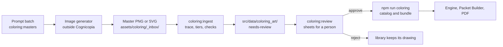

# Line-art pipeline: from a picture to crisp coloring pages at three tiers

How a drawing from an image generator (or an illustrator, or a scanner) becomes a Cognicopia Coloring page: clean vector art that prints at the clinical line weights, at all three cognitive tiers, from one picture. This is the runbook. The standards it enforces are in [cognicopia-coloring-standards.md](cognicopia-coloring-standards.md).

## What it does, in one paragraph

You supply **one master picture per subject**: black line art on white, 3:4, any line weight. The pipeline traces the picture's **center lines** (not its outlines), so the lines stay one clean stroke each, fits smooth curves to them, and works out what each tier shows. Tier 1 keeps the whole drawing. Tiers 2 and 3 merge small areas into their neighbors, drop small details and redraw the outlines rounder and simpler. The page is then drawn by the same engine as every other (`CognicopiaColoring`) at the print standard's weights: **3 pt (Tier 1), 4.5 pt (Tier 2) and 7.9 pt (Tier 3), never under 3 pt**. The result is vector all the way to the PDF, works offline and flows through the Packet Builder, the catalog and the packs unchanged. Nothing reaches a resident until a person has looked at it and approved it.

There is also a lighter second route, for keeping a picture exactly as drawn as a closed-outline SVG; it is described [below](#a-second-lighter-route-trace-a-master-straight-to-svg). Both start from the same masters.



## Where the files live

| Folder or file | What | Published? |
|---|---|---|
| `assets/coloring/_inbox/` | Your master pictures and their sidecars | **No.** The folder starts with an underscore, so the Pages build leaves it out. Raw generator output is not committed by default; keep it out of the repository unless your license for the picture allows it. |
| `assets/coloring/_review/` | Review sheets (images and `index.html`) | **No**, and ignored by git. |
| `src/data/coloring_art/<design-id>.json` | One file per design: the traced strokes for each tier, where the picture came from, every check, and who reviewed it | Yes, as data. Only **approved** art is ever drawn. |
| `src/data/cognicopia_coloring_art.schema.json` | The schema of those files | Yes |
| `assets/cognicopia-coloring/cognicopia-coloring.js` | The offline bundle; it carries the approved art | Yes |

Nothing here needs a network or a server. The service worker already caches the bundle, so approved art works offline the same as the rest of the library.

## The routine

Run these from the repository root. Node 20 or later; no other installs (the scripts use Node's built-ins only). On Windows, run the same `npm run` commands in PowerShell or Command Prompt; paths with backslashes work too.

1. **Get prompts.** `npm run coloring:masters -- --out masters-01` writes `masters-01.jsonl` and `masters-01.csv`: one prompt per library design, each worded for three generators (Midjourney, Stable Diffusion, DALL·E 3). Add `--category botanical-garden` for one category, `--count 12` for a small first batch. Subjects that fail the dignity filter are left out. Nothing is sent anywhere.
   The owner's own picture descriptions, one for each of the 150 library designs, live in `src/data/coloring_owner_prompts.json`. `--masters` uses each one as the job's subject and keeps the full wording, word for word, as `prompts.owner` (the last column of the `.csv`), so that is the text to paste into the image maker. `--library-words` uses the built-in subject words instead. A new description must pass the dignity filter; `scripts/check-coloring.mjs` checks that all 150 do.
2. **Generate the pictures** in the tool you license. Ask for one picture per prompt: black line art on white, a single clear subject, 3:4. Line weight does not matter, because the engine draws the lines; closed shapes do.
3. **Save each picture** into `assets/coloring/_inbox/` named after the design: `sunflower.png` for the library design `sunflower` (the file name is the design's id, listed in the `.csv`). A name that is not a library design adds a **new design** (see below).
4. **Ingest.** `npm run coloring:ingest` traces every new picture, works out the three tiers, runs the checks and writes `src/data/coloring_art/<design>.json` as **needs-review**. `npm run coloring:ingest -- --list` shows what is waiting; `--dry-run` reports without writing; `--only sunflower` does one.
5. **Review.** `npm run coloring:review` writes one sheet per picture to `assets/coloring/_review/` and an `index.html` that lists them. Open `index.html`. Each sheet shows the master (a red ring marks any line that stops close to another line, in case a shape was meant to be closed) and then Tier 1, Tier 2 and Tier 3 exactly as they print, with the current drawing underneath when the picture replaces one.
6. **Approve or reject.**
   - `npm run coloring:ingest -- --approve sunflower --reviewer "Your name"`
   - `npm run coloring:ingest -- --reject sunflower --reviewer "Your name" --reason "Wings are the wrong shape"`

   A failed measured check needs `--override "why"` to approve. Approval records the reviewer, the date and a hash of the strokes; if anyone edits the art file afterwards, the build refuses it until it is reviewed again.
7. **Publish.** `npm run coloring` regenerates the catalog and the bundle with the approved art. `npm run build` checks everything. Commit the changed files and push.

A rejected picture leaves the library's own drawing in place. `--redo` traces a picture again after you replace the master.

### What a person checks

The ingest measures: pure black and white, line weight, area size, subject fills the page, **trace faithful to the master** (no stray or missing lines), no large solid black area, file size, dignity wording and closed shapes. Five checks are confirmed by eye, because only a person can: the tier looks right, the style is adult and dignified, it is true to life (no extra limbs, warped hands or impossible machines), there are no letters or signatures, and the subject is gentle (check the resident avoid-topics list). A sixth: **we have the right to use the picture** (see Rights below).

Look at all three tiers on every sheet. The subject should stay clear at Tier 3, and no line should look torn or odd.

## New designs, per-tier drawings and sidecars

**A new design.** Name the picture something that is not a library design, for example `porch-lighthouse.png`, and add a sidecar `porch-lighthouse.json`:

```json
{
  "title": "Lighthouse by the Shore",
  "category": "home-everyday",
  "conversation_prompt": "What did you like to look at from a porch?",
  "tags": ["coast", "summer"],
  "season": "summer",
  "era": "any",
  "generator": "the tool you used",
  "prompt": "the words you gave it",
  "license": "Generated under our plan; commercial use allowed",
  "author": "who made or commissioned it"
}
```

The new design gets the id `ai-porch-lighthouse` and appears in the Packet Builder with the rest. Without a `category` the picture is skipped (`--category <id>` supplies one for a whole batch); without a `title` the file name is used. `sensitive_topics` lists the avoid-topics a resident's list is matched against.

**A drawing made for a tier.** If the automatic Tier 2 or Tier 3 does not look right, supply your own: `sunflower.t3.png` (or `.t2.png`). It is traced and used as it is instead of working the tier out. Make it from the same prompt asking for fewer, larger areas.

**Tuning.** A sidecar may also set `fit` (`"subject"`, the default, or `"page"`) and `pad`, and `rules` or `trace` objects that override the tier and tracer settings (see `scripts/lib/tiers.mjs` and `scripts/lib/trace.mjs` for the names). Use them sparingly.

A jobs file from step 1 (`--jobs masters-01.jsonl`) fills in the sidecar details (title, category, prompt, tool) for any picture named after its job id.

## How the tiers are worked out

1. Tier 1 is the traced drawing as it is.
2. For each of Tiers 2 and 3 the pipeline paints the strokes as walls, labels the areas between them and merges small areas into the neighbor they share the longest border with, round by round, until the page has about **70% (Tier 2) and 36% (Tier 3)** of Tier 1's areas, within the tier's limits. The cut is chosen by running candidates through the real engine and measuring them, not by a guess.
3. Strokes that no longer separate two areas become small details and are dropped, except accents (eyes, buttons, knobs) that are big enough to matter.
4. The outlines of the merged areas are redrawn from a smoothed map of those areas, so they are rounder and simpler, never ragged.

Every tier is measured through the engine (areas to color, smallest area, areas under the minimum) and must meet the tier's rule from [cognicopia-coloring-standards.md](cognicopia-coloring-standards.md). A tier that does not is marked in the checks and in the review sheet.

## Making masters on your own computer: the local art agent

Masters no longer need an outside generator. `npm run art:make -- --only <design>` makes them on the owner's own computer from the owner's description of each design, with ComfyUI or a downloaded picture model, and nothing leaves the computer. It cleans each try to a 1-bit 1800 x 2400 master at 300 dpi with 3 pt lines, scores it with this ingest's own checks in a dry run, keeps the best and writes it with its sidecar into `assets/coloring/_inbox/`. From there the routine above is unchanged. `npm run art:library` shows which designs to remake first. The guide is `docs/local-art-agent.md`.

## A second, lighter route: trace a master straight to SVG

`scripts/build_coloring_svgs.py` is for when a picture should stay exactly as it was drawn, as a closed-outline SVG that a page can show and print, without working out simpler tiers or a review record. It reads the same masters (`assets/raw_coloring_pngs/` or `assets/coloring/_inbox/`; neither is published, and the first is ignored by git), makes each one pure black on white, removes specks, crops to the drawing and centers it on a 3:4 page (a 600 x 800 viewBox) with a margin, and traces it with VTracer in binary mode with spline fitting and a speckle filter, so the curves are smooth rather than pixel steps. It keeps only closed paths, writes pure black fills, and writes two things: `assets/svgs/<name>.svg`, and one generated file, `js/coloring-data.js`, holding the same SVG text so a page can draw it with no network request (a `fetch` fails on `file://` and on a computer that is offline).

```
pip install pillow vtracer               # once; Python 3.9 or later
python3 scripts/build_coloring_svgs.py   # or: npm run coloring:svgs
npm run coloring:svgs:check              # exits 1 if js/coloring-data.js is not what the SVGs make
```

Options: `--only NAME` traces one picture, `--list` says what would be traced and writes nothing, `--speckle N` sets the speckle filter, `--src DIR` and `--out DIR` change the folders. Where Pillow or vtracer is missing the script says so, exits 2 and writes nothing, and `npm run build` does not need Python (the design check skips the tracing test with a note). Set `PYTHON=/path/to/python` to run the checks with another interpreter. A picture that traces to nothing (a blank page) is refused and the others still trace; the script makes no network request.

A page draws a picture with `CognicopiaSvgColoring.mount(element, "name", { tier: 2, sheet: true })` (`js/coloring.js`, loaded after `css/styles.css` and `js/coloring-data.js`). The tier class puts the line weight on it: **3 pt, 4.5 pt and 7.875 pt, never under 3 pt**, with `vector-effect: non-scaling-stroke`, as in the [design system](design-system.md). `js/coloring.js` rebuilds the SVG from an allow-list and refuses a picture with an open outline, the wrong shape or no outline, with a plain message.

**Which route.** Choose on purpose:

| | `coloring:ingest` (this runbook) | `build_coloring_svgs.py` |
|---|---|---|
| Traces | The center line, one stroke each; the engine draws the weight | The outline of the ink; the line weight is the master's own, with the tier's weight added on top by CSS |
| Tiers | Derived: Tiers 2 and 3 get fewer, rounder, larger areas | The same picture at three line weights; for simpler shapes, supply a simpler picture |
| Review and approval | Sheets, measured checks, and a record of who approved it | None: look at each SVG yourself before a page uses it (dignity, rights, no letters) |
| Feeds | The catalog, the bundle, the Packet Builder and its PDFs | `js/coloring.js` only. **Not wired into a screen yet, and no masters are committed, so `js/coloring-data.js` is empty today** |
| Needs | Node only | Python with Pillow and vtracer |

**Masters to live, in one list.**

1. `npm run coloring:masters -- --out masters-01` writes a prompt for each subject.
2. Make the pictures on your own computer with `npm run art:make` (`docs/local-art-agent.md`), which puts each master in `assets/coloring/_inbox/`; or make them in a program you license and save each there yourself (for the SVG route, `assets/raw_coloring_pngs/`).
3. Run the route you chose: `npm run coloring:ingest`, then `npm run coloring:review`, then approve; and/or `python3 scripts/build_coloring_svgs.py`.
4. After approving art, `npm run coloring`, then `npm run nav` (the Studio hub page shows the picture count), then `npm run build`. Commit what changed (never a master you may not redistribute), push, and open a pull request to `main`.

## Limits worth knowing

- **Derived tiers are an automatic baseline.** They are very good for subjects made of areas (flowers, animals, buildings, vehicles with bodies) and weaker for skeletal line drawings (a bicycle's spokes, a wire frame) and for dense repeating patterns (quilts, mandalas, tile patterns). For those, supply a drawing for the tier (above), tune `rules` in the sidecar, or reject the picture and keep the library's drawing, which was designed by hand for each tier.
- **How it did on stand-ins.** As a trial, all 150 library designs were drawn as pictures an image generator might return (wandering lines of uneven weight) and put through the pipeline: 132 came through with nothing flagged, in about 4 seconds and 24 KB each. The 18 flagged were mostly quilts, tiles and mandalas (a tier broke its area rule, or Tier 2 had more areas than Tier 1) and a few drawings with thin features that the trace-faithfulness check caught. Real pictures will differ, and that is what the review sheet is for.
- **Closed shapes.** A line that stops a little short of another leaves an open area that cannot be colored. The tracer closes small gaps and the sheet rings the rest, but a picture with many open shapes should be regenerated.
- **Size.** Each replaced design adds about 20 to 35 KB to the bundle. The generator refuses more than 6 MB of art in total. If the whole library were replaced (about 4 MB) the bundle would be large for a first visit; split it by category before going past about 150 designs.
- **No outside service.** The page loads no code from a server, and nothing here calls a generator or uploads a picture. The offline rule for the static site is unchanged.

## Rights, records and tone

- The `rights` check is confirmed by a person: record the **tool, the plan or license, the prompt and the date** in the sidecar so the file says where the picture came from. Many generators restrict commercial use on free plans; check yours before approving.
- Do not trace a picture you do not have the right to use, and do not commit a master unless your license allows redistribution. The committed art is only the traced strokes.
- No faces of real people, no names, no text in the art. Pictures are subjects (a porch, a tractor, a bird), never anything that quizzes or labels a person.
- Dignity-first: adult style, nothing cute, nothing frightening. If the picture would not be put in front of an adult relative, reject it.

## Commands at a glance

| Command | Does |
|---|---|
| `npm run coloring:masters -- --out masters-01` | A prompt batch: one master per library design |
| `npm run art:make -- --only <design>` | Make a master on this computer and put it in the inbox (`docs/local-art-agent.md`) |
| `npm run coloring:ingest` | Trace and check every picture in the inbox; hold it for review |
| `npm run coloring:ingest -- --list` | What is waiting and what is approved |
| `npm run coloring:review` | Review sheets and `index.html` in `assets/coloring/_review/` |
| `npm run coloring:ingest -- --approve <design> --reviewer "Name"` | Approve |
| `npm run coloring:ingest -- --reject <design> --reviewer "Name" --reason "why"` | Reject |
| `npm run coloring` | Write the catalog and bundle with the approved art |
| `npm run coloring:svgs` | The SVG route: trace every master in `assets/raw_coloring_pngs/` and `assets/coloring/_inbox/` to `assets/svgs/` and `js/coloring-data.js` (needs Pillow and vtracer) |
| `npm run coloring:svgs:check` | Fails if `js/coloring-data.js` is not what the SVGs make |
| `npm test` | Includes `scripts/check-trace.mjs`: the tracer, the tier derivation, the art files and this command line, tested on drawings whose right answer is known; and `scripts/check-design-system.mjs`, which tests the SVG route's script (and, where Pillow and vtracer are installed, traces test pictures) |

## For developers

| File | Role |
|---|---|
| `scripts/lib/master.mjs` | Master to a clean 1-bit bitmap on a 6 × 8 in, 300 dpi canvas (Otsu threshold, specks, crop, margin); SVG masters are drawn to the same canvas |
| `scripts/lib/trace.mjs` | Center-line tracer: smoothing, thinning, skeleton graph, spur and gap cleanup, solid-area detection, cubic Bézier fitting |
| `scripts/lib/tiers.mjs` | Tier derivation and the through-the-engine measuring |
| `scripts/lib/art.mjs` | `buildArt`, the fidelity check, the art files and their hash |
| `scripts/lib/standins.mjs` | Library designs drawn as pictures an image generator might return, for tests and benchmarks |
| `assets/cognicopia-coloring/lineart.js` | The engine hook: `CognicopiaColoring.art.use(list)` draws a design from art records (`[kind, tier mask, path]`; mask 1 = Tier 1, 2 = Tier 2, 4 = Tier 3) |
| `scripts/build_coloring_svgs.py` | The SVG route: master PNG to a closed-outline SVG with VTracer; writes `assets/svgs/` and `js/coloring-data.js`; `--check` proves the data is current |
| `js/coloring.js`, `js/coloring-data.js` | `CognicopiaSvgColoring`: draws a picture into a page at a tier, from an allow-list, with no fetch; the data file is generated |
| `css/styles.css` (section 11) | The coloring sheet as CSS: Letter, 0.5 in margins, 0.75 in gutter, tier weights 3, 4.5 and 7.875 pt |
| `scripts/check-design-ui.mjs` | Draws pictures at each tier in a real browser and reads three printed sheets back from their PDFs (page size, margins, black and white only, line weights) |
| `scripts/generate_coloring_manifest.js` | Verifies approved art (hash, drawable, coordinates), measures every page, writes catalog and bundle (`source: "traced-art"`, `counts.traced`) |

The tracer and the tier derivation are deterministic: the same master gives the same art, byte for byte.
